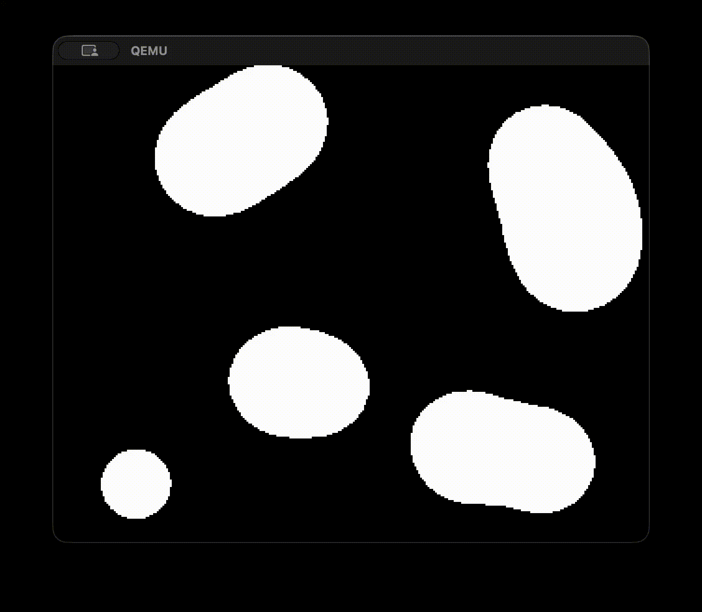

# ginnOS

ginnOS (Ginn short for Ginnungagap, and OS short for Operating System) is a unix-like hobby operating system, written from scratch in c and assembly, which i'm developing alongside a course on operating systems i'm taking at DTU.



I started this project because i wanted to understand how an operating system is really coded instead of just theory. I plan to keep building and improving it as i learn more.

The name ginnOS is taken from Ginnungagap, the primordial void in Norse mythology from which the world was created.

> "That was the age when nothing was; / There was no sand, nor sea, nor cool waves, / No earth nor sky nor grass there, / Only Ginnungagap."
> - Völuspá, Poetic Edda

### Documentation

I've recently started on writing documentation for this project in obsidian and hosting it using quartz, this can be read at: https://lassedtu.github.io/ginnOS-docs/

## Features

ginnOS is a 32-bit x86 (i686) Unix-like system written from scratch in C and
assembly. It boots on BIOS/QEMU via its own two-stage bootloader and drops
straight into a userspace shell. Everything below is implemented and working
today.

### Boot and kernel core

- Custom two-stage bootloader (stage1 MBR + stage2), real mode → protected mode
- x86 protected-mode kernel with GDT (ring 0/3 segments + TSS)
- IDT, 8259 PIC, IRQ handling and a 256-vector ISR framework
- Shared-IRQ registration layer (`irq_request`/`irq_free`, per-handler enable)
- Kernel panic + assertion infrastructure, unified `kerr_t` error type
- Symbolised backtraces on panics and CPU exceptions (frame-pointer walk +
  a symbol table embedded at build time), on screen and over serial
- E820 memory-map detection and boot-time region reservation
- Serial (COM1 16550 UART) driver + leveled kernel logging (`klog`) for
  headless debugging

### Memory management

- Physical memory manager (bitmap allocator)
- Kernel heap: first-fit allocator with splitting, coalescing, expansion —
  `kmalloc`/`kfree`/`krealloc` (in-place when possible)/`kcalloc`, allocation
  statistics, and an optional `HEAP_DEBUG` mode (redzone canaries, freed-memory
  poisoning)
- Virtual memory: a higher-half kernel at `0xC0000000` with a direct map of
  RAM, kernel page tables shared by every process, a separate user half per
  process, `ioremap` for device memory, a page-fault handler, and a
  map/unmap/translate API
- 8 KiB kernel stacks with an unmapped guard page below each; a double-fault
  task gate (its own TSS and stack) reports an overflow as a "kernel stack
  overflow" panic with a backtrace instead of a silent triple-fault reset
- User address space: the program at `0x400000` with read-only code, an
  unmapped null page, a heap after the program, an mmap region at
  `0x40000000`, and a stack below `0xC0000000` that grows on demand up to
  16 MiB with a guard page under it
- Each process keeps a table of its memory areas (VMAs). Pages are allocated
  when they are first touched, and a bad access kills only the process
  ("segmentation fault", killed by SIGSEGV) instead of the kernel
- `mmap` (anonymous and device-backed, `MAP_FIXED`), `munmap` and `mprotect`

### Processes and multitasking

- Process table with per-process page directory, kernel stack, fd table, cwd
- `/bin/sh` starts as PID 1 through the normal scheduler path; if it exits,
  the system halts
- ELF32 loader (`PT_LOAD` mapping) with `argc`/`argv` passing
- Ring 3 execution via `iret`, TSS kernel-stack switching
- Round-robin scheduler with an O(1) intrusive ready queue and an idle (hlt)
  task
- Parent/child relationships, `waitpid` with zombie reaping; a process frees
  its fds, argv and address space when it exits, and orphans are reaped by the
  kernel
- fd inheritance across `exec` (close-on-exec for pipe fds beyond stdio)

### Concurrency

- Syscalls are preemptible, so shared kernel state is locked: spinlocks
  (`spin_lock_irqsave`) on the heap, PMM, process table, pipes, keyboard ring,
  console, device registry and mount table; a sleeping `mutex_t` serialises
  ext2 and whole console writes. The rules are written down at the top of
  `src/kernel/sync/spinlock.h`
- Generic wait queues (block/wake-one/wake-all), and
  `wait_queue_block_locked()` to sleep on a condition without losing a wakeup;
  pipes and keyboard reads sleep instead of busy-waiting

### Filesystem and I/O

- VFS layer with a mount table (longest-prefix resolution) and a filesystem
  operations vtable (`fs_ops_t`) — the VFS never calls a filesystem directly
- ext2 driver: reads through direct and single/double/triple-indirect blocks;
  writes are limited to the 12 direct blocks for now (12 KiB with 1 KiB
  blocks); inode and block allocation, directory operations (create, remove,
  read, write, truncate, stat, rename), re-entrant per-volume scratch buffers
- devfs mounted at `/dev`, enumerating the device registry (`fb0`, `tty0`,
  `hda`, `hda1`, `pit`, `kbd`)
- Block-device abstraction (ATA PIO driver + MBR partition parsing)
- Pipes (circular buffers) with blocking, EOF/EPIPE, reference-counted endpoints
- `dup2` fd redirection

### System calls

- 27 syscalls via `int 0x80` with proper `-errno` returns
- User pointers are checked against the page tables (`copy_from_user`,
  `copy_to_user`, `strncpy_from_user`): a bad pointer returns `-EFAULT`
  instead of crashing the kernel
- Process/IO: `exit`, `write`, `read`, `open`, `close`, `stat`, `create`,
  `mkdir`, `exec`, `getpid`, `waitpid`, `sbrk`, `getcwd`, `chdir`, `readdir`,
  `unlink`, `rmdir`, `pipe`, `dup2`, `ftruncate`, `lseek`
- Device/terminal/graphics: `ttyctl`, `ioctl` (general device control),
  `mmap`, `munmap`, `mprotect`, `pollkey`

### Terminal and graphics (Bifröst framebuffer)

- Layered TTY: a device-independent VT/ANSI terminal state machine
  (`tty_backend_t`) decoupled from the output device
- VGA text-mode backend (fallback console)
- Linear VBE framebuffer: bootloader mode-set with full pixel-format reporting
  (channel size/shift masks), a driver with pixel primitives, and LFB mapping
- Framebuffer console: JetBrains Mono bitmap-font glyph renderer (font baked
  offline from a TTF), SGR colours, VT100 growth, and double buffering with
  dirty-row flushing — with automatic fallback to VGA text when no framebuffer
  is present
- Linux-style **`/dev/fb0`** framebuffer device: a char device with
  `read`/`write`/`lseek`/`ioctl`/`mmap`, exposing `fb_fix_screeninfo` /
  `fb_var_screeninfo` (per-channel bitfields) — the stable userspace graphics
  interface. A `metaballs` demo draws to it via `open` + `ioctl` + `mmap`.

### C standard library (libc.a)

- `<string.h>`: `strlen`, `strcpy`/`strncpy`, `strcat`, `strcmp`/`strncmp`,
  `strchr`/`strrchr`, `strstr`, `strtok`, `memcpy`/`memmove`/`memset`/`memcmp`
- `<stdio.h>`: `printf`/`fprintf` (`%s %d %u %x %c %%`), `puts`, `putchar`
- `<stdlib.h>`: `atoi`, `malloc`/`free`, `exit`
- `<unistd.h>`: the full syscall surface (`read`/`write`/`open`/`close`/`exec`/
  `waitpid`/`pipe`/`dup2`/`lseek`/`ioctl`/`readdir`/… and `read_event`)
- `<sys/mman.h>` (`mmap`, `munmap`, `mprotect`), `<sys/fb.h>` (framebuffer)
- `<errno.h>`: `errno`, `perror`, `strerror`
- `crt0` with `argc`/`argv` setup; `int 0x80` syscall stubs

### Userspace shell (skl -> /bin/sh)

- Line editor: cursor movement, insert/delete, Home/End, Ctrl+A/E/K/U/W/L/D
- Command history (128 entries, Up/Down, dedup)
- Environment variables (`export`, `unset`, `env`, `printenv`, `which`) with
  `$VAR` / `${VAR}` / `$?` / `$$` expansion
- PATH-based command lookup
- Tokenizer with double/single quoting and backslash escaping
- Pipelines (`cmd1 | cmd2 | cmd3`) and I/O redirection (`>`, `>>`, `<`)
- Builtins: `cd`, `exit`, `history`, `export`, `unset`, `env`, `printenv`,
  `which`

### Bundled userspace programs

- `cat`, `clear`, `echo`, `ls`, `mkdir`, `pwd`, `rm`, `rmdir`, `sh`, `touch`,
  `ze` (text editor), a `metaballs` framebuffer demo, and `memtest`, which
  tests the kernel's handling of user memory (heap, stack growth, `mmap`,
  `munmap`, `mprotect`, and faults that must kill only the process)

### Portability and tooling

- Architecture-neutral abstraction layers (`arch_*` for interrupts, MMU,
  context switch, boot protocol) with x86 as the only current backend —
  groundwork for a future x86_64 port
- Pointer-width types throughout (`uintptr_t`/`size_t`/`phys_addr_t`, one
  `PAGE_SIZE`, `phys_to_virt`/`virt_to_phys`, a `syscall_arg()` accessor) and
  compiler-checked printf formats
- Multi-arch-ready build system (`ARCH` switch), `make lint` (clang-tidy),
  `make check64` (x86_64 portability check), `make format` (clang-format),
  `make gdb`/`make debug` (QEMU + gdb attached), `make iso` (GRUB-bootable), and `compile_commands.json`
  generation for LSP
- Consistent `snake_case` conventions documented in `STYLE.md`; ext2 image and
  bitmap-font helper tools under `tools/`

## macOS Toolchain Setup (Manual)

### Clone the project

```bash
git clone https://github.com/lassedtu/ginnOS
cd ginnOS
```

### Install host dependencies

Only install what this two-stage build needs:

```bash
brew install gmp mpfr libmpc texinfo nasm qemu
brew install gdb   # optional, for make gdb / make debug
```

### Build i686 cross compiler manually

Create build directories:

```bash
mkdir -p "$HOME/src/cross"
mkdir -p "$HOME/opt/cross"
cd "$HOME/src/cross"
```

Build and install binutils:

```bash
curl -LO https://ftp.gnu.org/gnu/binutils/binutils-2.42.tar.xz
tar -xf binutils-2.42.tar.xz
mkdir -p build-binutils
cd build-binutils

../binutils-2.42/configure \
  --target=i686-elf \
  --prefix="$HOME/opt/cross" \
  --with-sysroot \
  --disable-nls \
  --disable-werror

make -j"$(sysctl -n hw.ncpu)"
make install
cd ..
```

Build and install GCC (C only):

```bash
curl -LO https://ftp.gnu.org/gnu/gcc/gcc-14.2.0/gcc-14.2.0.tar.xz
tar -xf gcc-14.2.0.tar.xz
mkdir -p build-gcc
cd build-gcc

../gcc-14.2.0/configure \
  --target=i686-elf \
  --prefix="$HOME/opt/cross" \
  --disable-nls \
  --enable-languages=c \
  --without-headers

make -j"$(sysctl -n hw.ncpu)" all-gcc all-target-libgcc
make install-gcc install-target-libgcc
cd ..
```

### Add cross toolchain to PATH

```bash
echo 'export PATH="$HOME/opt/cross/bin:$PATH"' >> ~/.zshrc
source ~/.zshrc
```

### Verify required tools

```bash
i686-elf-gcc --version
i686-elf-ld --version
i686-elf-objcopy --version
nasm -v
qemu-system-i386 --version
```

## NixOS / Nix Toolchain Setup

A `shell.nix` is included at the project root. It pulls in the `i686-elf` cross-compiler, binutils, NASM, QEMU, and Python 3, no manual toolchain build required.

### Enter the dev shell

```bash
nix-shell
```

All required tools (`i686-elf-gcc`, `i686-elf-ld`, `i686-elf-objcopy`, `nasm`, `qemu-system-i386`, `python3`) will be on your `PATH` inside the shell.

### Build and run

```bash
make
make run
```

Run the in-kernel test suite (boots a separate test kernel headless and exits
with the result):

```bash
make test
```

## Ubuntu / Debian Toolchain Setup (Manual)

### Clone the project

```bash
git clone https://github.com/lassedtu/ginnOS
cd ginnOS
```

### Install host dependencies

Only install what this two-stage build needs:

```bash
sudo apt update
sudo apt install build-essential curl nasm qemu-system-x86 \
  libgmp-dev libmpfr-dev libmpc-dev texinfo bison flex \
  python3 e2fsprogs
sudo apt install gdb   # optional, for make gdb / make debug
```

### Build i686 cross compiler manually

Create build directories:

```bash
mkdir -p "$HOME/src/cross"
mkdir -p "$HOME/opt/cross"
cd "$HOME/src/cross"
```

Build and install binutils:

```bash
curl -LO https://ftp.gnu.org/gnu/binutils/binutils-2.42.tar.xz
tar -xf binutils-2.42.tar.xz
mkdir -p build-binutils
cd build-binutils

../binutils-2.42/configure \
  --target=i686-elf \
  --prefix="$HOME/opt/cross" \
  --with-sysroot \
  --disable-nls \
  --disable-werror

make -j"$(nproc)"
make install
cd ..
```

Build and install GCC (C only):

```bash
curl -LO https://ftp.gnu.org/gnu/gcc/gcc-14.2.0/gcc-14.2.0.tar.xz
tar -xf gcc-14.2.0.tar.xz
mkdir -p build-gcc
cd build-gcc

../gcc-14.2.0/configure \
  --target=i686-elf \
  --prefix="$HOME/opt/cross" \
  --disable-nls \
  --enable-languages=c \
  --without-headers

make -j"$(nproc)" all-gcc all-target-libgcc
make install-gcc install-target-libgcc
cd ..
```

### Add cross toolchain to PATH

```bash
echo 'export PATH="$HOME/opt/cross/bin:$PATH"' >> ~/.bashrc
source ~/.bashrc
```

If you use zsh instead of bash, append the same line to `~/.zshrc`.

### Verify required tools

```bash
i686-elf-gcc --version
i686-elf-ld --version
i686-elf-objcopy --version
nasm -v
qemu-system-i386 --version
```

## Windows Toolchain Setup (WSL2)

ginnOS uses `make`, a cross-compiler, NASM, and QEMU. On Windows, the simplest way to get all of that working is **WSL2** with Ubuntu, you get the same Linux toolchain as on a native install, without fighting MSYS or native Windows ports.

### Install WSL2 and Ubuntu

Open **PowerShell as Administrator** and run:

```powershell
wsl --install -d Ubuntu
```

Restart if Windows asks you to. When you're back, Ubuntu will finish setup and prompt you to create a Linux user account.

If WSL is already installed and you only need the distro:

```powershell
wsl --list --online
wsl --install -d Ubuntu
```

### Clone the project inside WSL

Open Ubuntu (Start menu, or type `wsl` in PowerShell) and work from the Linux filesystem, for example `~/projects/ginnOS`.

Avoid building from `/mnt/c/...` if you can; file I/O across the Windows/Linux boundary is noticeably slower and can cause odd issues with tools like `make`.

```bash
mkdir -p ~/projects
cd ~/projects
git clone https://github.com/lassedtu/ginnOS
cd ginnOS
```

### Install the toolchain

Everything from here is the same as on native Ubuntu. In your WSL terminal, follow the **Ubuntu / Debian Toolchain Setup** section:

1. Install host dependencies
2. Build the i686 cross compiler manually
3. Add the cross toolchain to `PATH`
4. Verify required tools

Once that is done, build from the project root, see **Build and Run** below. QEMU should open in its own window; on most Windows 11 + WSL2 setups this works without extra configuration.

## Build and Run

From project root:

```bash
make
make run
```

Run the in-kernel test suite (boots a separate test kernel headless and exits
with the result):

```bash
make test
```

Check the kernel for 64-bit portability (needs a host `clang`; nothing is
built or run). It compiles every kernel, driver, filesystem and test source
for x86_64 without linking, and fails on any pointer/integer cast, 64-to-32-bit
narrowing or printf format mismatch, so code that only works with 32-bit
pointers is caught before the x86_64 port:

```bash
make check64
```

Debug the kernel with gdb. QEMU starts halted with a gdb stub, gdb attaches
with `build/kernel.elf` and `tools/gdb/ginnos.gdb` (breakpoints on
`kernel_panic`/`kernel_panic_at`), and QEMU stops when gdb exits. Type `c` to
boot. `make debug` does the same with the kernel built `-Og -DDEBUG`, which is
easier to step through:

```bash
make gdb                 # optimised kernel, with debug info
make debug               # -Og kernel
make gdb GDB_PORT=1240   # if port 1234 is taken
```

gdb must support i386 (Homebrew's and most distro `gdb` builds do; set
`GDB=...` to use another one, e.g. `i686-elf-gdb`). Kernel panics and CPU
exceptions also print a symbolised backtrace on screen and over serial, so
many crashes can be read without a debugger.

## ext2 Side-Disk Helper

The ext2 helper now builds an image from a real folder tree.

Default root folder:

- [tools/ext2/rootfs](tools/ext2/rootfs)

Generate an ext2 image using the default folder:

```bash
make ext2-image
make run-ext2
```

Generate an ext2 image from any folder on your machine:

```bash
make ext2-image EXT2_SOURCE_DIR=/absolute/path/to/your/folder
```

Optionally force a custom image size (MiB):

```bash
make ext2-image EXT2_SOURCE_DIR=/absolute/path/to/your/folder EXT2_SIZE_MB=64
```

If omitted, the helper auto-sizes the image from folder contents.

If you want the ext2 helper available on macOS, install:

```bash
brew install e2fsprogs
```

The helper tool is located at:

- [tools/ext2/make_image.py](tools/ext2/make_image.py)

## Framebuffer Font Tool

The framebuffer terminal (bifrost) renders text with a bitmap font baked from a
TrueType font. The kernel stays a simple bitmap blitter, no TrueType rasterizer
runs at runtime: [tools/font/make_font.py](tools/font/make_font.py) rasterizes a
TTF offline and emits the C header the renderer uses
([src/drivers/video/fb/font.h](src/drivers/video/fb/font.h)), which is committed
so the normal build has no font dependency.

The default is JetBrains Mono Regular at a 10x20 cell. Regenerate the header
(only needed when changing font/size):

```bash
python3 tools/font/make_font.py src/drivers/video/fb/font.h
```

Use a different font, size, or cell:

```bash
python3 tools/font/make_font.py \
  --font /path/to/Font-Regular.ttf --size 16 --cell 10x20 \
  src/drivers/video/fb/font.h
```

The tool needs Pillow:

```bash
pip install Pillow
```

JetBrains Mono is licensed under the SIL Open Font License 1.1; the notice is
copied into the generated header.

## Credits and Learning Resources

- Nanobyte: https://www.youtube.com/@nanobyte-dev
  Operating system tutorials that have been a big help.

- OSDev Wiki: https://wiki.osdev.org/
  The main reference used for low level concepts and implementation.
