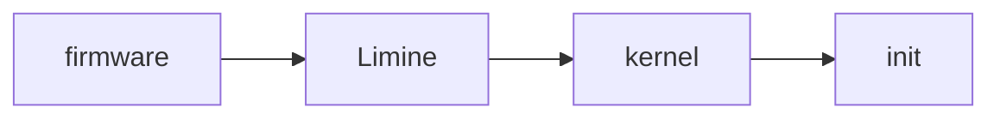

# How to write these docs

These rules apply to every page in `docs/`.

## What a page is

A page tells how a thing is now and how to use it. It does not tell the
history of how the thing was made.

- Write one subject on each page.
- Do not write dates, plans or "first we tried". The git log and the
  pull requests keep the history.
- Write the page from the code as it is now. If the code and an old
  note do not agree, the code is correct.
- Change the page in the same pull request as the code that it
  describes.

## The three parts

| Folder | For | Example subjects |
| --- | --- | --- |
| `use/` | people who use ginnOS | install, the desktop, the terminal, settings |
| `develop/` | people who write programs for ginnOS | the toolchain, libc, the libraries, ports |
| `internals/` | people who work on ginnOS itself | the boot, memory, the scheduler, the drivers |

Put a page in the part of its reader. If two readers need the same
subject, write it one time and link to it from the other part.

## The reference

The [reference](https://lassedtu.github.io/ginnOS-docs/reference/) is not in `docs/`. Doxygen makes it from the doc
comments (`/** ... */`) in `src/libc/include/`, `src/lib/`, `src/kernel/`,
`src/arch/`, `src/drivers/`, `src/fs/` and `src/common/`, each time the
site is built. The settings are in
[`tools/docs/Doxyfile`](https://github.com/lassedtu/ginnOS/blob/main/tools/docs/Doxyfile).

To change the reference, change the comment in the source. To see the
result on your computer, run `make docs` and open
`build/docs/html/index.html`. Doxygen writes its warnings to
`build/docs/warnings.txt`.

## The page template

```markdown
# The subject

One or two sentences: what the subject is.

The code: [`src/kernel/net/`](https://github.com/lassedtu/ginnOS/tree/main/src/kernel/net)

## How it works

## How to use it
```

Start with what the subject is and where its code is. Then tell how it
works. Then tell how to use it. A page for users can leave out "How it
works".

## The language

Write the text in ASD-STE100 Simplified Technical English, as the code
comments are.

- Write short sentences: 20 words or fewer for an instruction, 25 words
  or fewer for a description.
- Write one instruction in each sentence.
- Use the imperative for instructions: "Run `make test`."
- Use the active voice: "The kernel loads the program", not "the
  program is loaded".
- Use the present, the simple past and the simple future only.
- Do not use "-ing" forms, except in technical names.
- Keep "the", "a" and "an".
- Use one word for one thing on all the pages.
- Write a warning before the instruction that it is for: "Make sure
  that the device name is correct. `dd` erases the disk."
- Use sentence case for headings.

Write names from the screen exactly as the screen shows them: Log out,
Power off, Incorrect password.

## Commands and examples

- Run every command and every example before you write it down.
- Show the output when the reader must compare it.
- Write a command that the user types on ginnOS with the `$` prompt of
  the ginnOS shell. Write a command for the build machine without a
  prompt.

## Links

- Link to another page with a relative path: `[the toolchain](../develop/toolchain.md)`.
- Link to the source code with a full GitHub address, because the site
  does not contain the source:
  `https://github.com/lassedtu/ginnOS/blob/main/src/libc/include/stdio.h`.
- A page that describes an interface links to its header or to the
  reference. Do not copy the list of functions into the page.

## Diagrams

Draw diagrams in Mermaid, in a `mermaid` code block. GitHub and the
site both show them.

````markdown

````

## The site

The pages are plain Markdown. GitHub shows them in the repository, and
mkdocs makes the site from them. The site set-up is not in this
repository. When a pull request that changes `docs/` merges to `main`,
the workflow `.github/workflows/docs.yml` tells the site repository to
build the site again.

To see the site on your computer, see the README of the site
repository.
