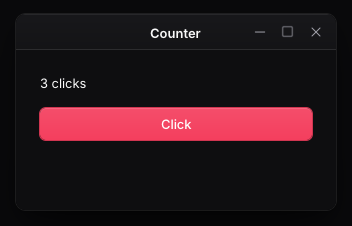

# The libraries

ginnOS has its own libraries for programs on the desktop. They are in
[`src/lib/`](https://github.com/lassedtu/ginnOS/tree/main/src/lib).
Each library has its header in `src/lib/<name>/include/`, with a doc
comment for each function.

| Library | What it does | Header |
| --- | --- | --- |
| gfx | draws into pixel buffers in memory: rectangles, lines, rounded rectangles, gradients, shadows, blur, copies and blends. Pixels are premultiplied ARGB, 32 bits. | [`gfx.h`](https://github.com/lassedtu/ginnOS/blob/main/src/lib/gfx/include/gfx.h) |
| heimdall | connects to the window server: windows, their buffers, events, the clipboard | [`heimdall.h`](https://github.com/lassedtu/ginnOS/blob/main/src/lib/heimdall/include/heimdall.h), [`heimdall_proto.h`](https://github.com/lassedtu/ginnOS/blob/main/src/lib/heimdall/include/heimdall_proto.h) |
| bragi | draws TrueType text (UTF-8) into gfx buffers | [`bragi.h`](https://github.com/lassedtu/ginnOS/blob/main/src/lib/bragi/include/bragi.h) |
| idunn | the widget toolkit: windows, layouts, buttons, fields, lists, menus, dialogs, and the light and dark theme | [`idunn.h`](https://github.com/lassedtu/ginnOS/blob/main/src/lib/idunn/include/idunn.h), [`idunn_theme.h`](https://github.com/lassedtu/ginnOS/blob/main/src/lib/idunn/include/idunn_theme.h) |
| conf | reads and writes the settings files (see [The settings files](../use/settings-files.md)) | [`conf.h`](https://github.com/lassedtu/ginnOS/blob/main/src/lib/conf/include/conf.h) |
| apps | reads the `.app` files of the launcher | [`apps.h`](https://github.com/lassedtu/ginnOS/blob/main/src/lib/apps/include/apps.h) |
| mime | finds the type and the icon of a file | [`mime.h`](https://github.com/lassedtu/ginnOS/blob/main/src/lib/mime/include/mime.h) |
| icon | draws icons from the icon packs in `/usr/share/icons` | [`icon.h`](https://github.com/lassedtu/ginnOS/blob/main/src/lib/icon/include/icon.h) |
| image | loads PNG, JPEG and BMP files into gfx buffers (with stb_image) | [`image.h`](https://github.com/lassedtu/ginnOS/blob/main/src/lib/image/include/image.h) |
| vt | a terminal emulator without a screen: bytes go in, a grid of cells comes out | [`vt.h`](https://github.com/lassedtu/ginnOS/blob/main/src/lib/vt/include/vt.h) |

Most apps use idunn, which uses the other libraries. Use gfx and
heimdall alone only for a program that draws all of its window itself,
such as a game.

The sysroot of the ginnOS toolchain has only gfx and heimdall. To use
the other libraries, build your program in the ginnOS tree, as below.

## Write a desktop program

This program shows a window with a label and a button. Each click
counts up.



1. Make a folder for the program, `src/user/counter/`.
2. Write the program in `src/user/counter/counter.c`:

   ```c
   #include <idunn.h>
   #include <stdio.h>

   static int clicks;

   static void on_click(idunn_widget_t *button, void *data)
   {
       (void)button;
       char text[32];
       snprintf(text, sizeof(text), "%d clicks", ++clicks);
       idunn_label_set_text(data, text);
   }

   int main(void)
   {
       idunn_app_t *app = idunn_app_new("Counter");
       idunn_window_t *win = idunn_window_new(app, "Counter", 320, 160);
       idunn_widget_t *col = idunn_column(4, 6);
       idunn_widget_t *label = idunn_label("0 clicks", IDUNN_TEXT_BODY);
       idunn_add(col, label);
       idunn_add(col, idunn_button("Click", IDUNN_PRIMARY, on_click, label));
       idunn_window_set_root(win, col);
       return idunn_app_run(app);
   }
   ```

3. Write `src/user/counter/Makefile`. `LIBS` lists the libraries. A
   library comes before the libraries that it uses:

   ```make
   PROG := counter
   SRCS := counter.c
   LIBS := idunn heimdall bragi icon image conf gfx
   include ../program.mk
   ```

4. Build the image and start it:

   ```sh
   make run
   ```

   `make` finds each `src/user/*/Makefile` and puts the program in
   `/bin`.
5. Log in, open Mimir and type `counter`.

`idunn_column(4, 6)` is a column with a gap of 4 units and a padding of
6 units. A unit is 4 design pixels. The theme scales design pixels on
a large screen.

### Add the program to the launcher

Put a `.app` file in
[`tools/ext2/rootfs/usr/share/applications/`](https://github.com/lassedtu/ginnOS/tree/main/tools/ext2/rootfs/usr/share/applications),
for example `counter.app`:

```ini
[app]
name = Counter
comment = Count clicks
exec = counter
icon = application-x-executable
category = Development
```

| Key | Value |
| --- | --- |
| `name` | the name in the launcher. Necessary. |
| `exec` | the command. Necessary. The first word is a path, or a name in `/bin`. |
| `comment` | a short description. The launcher search also finds words in it. |
| `icon` | the name of a Tela icon |
| `category` | `Accessories`, `Development`, `Games`, `Graphics`, `Sound`, `System` or `Other`. Another value shows as Other. |
| `hidden` | `true` keeps the program out of the launcher |

## Look at the widgets

The Gallery app (`idunn-gallery`) shows all the idunn widgets in the
light and the dark theme. Its code,
[`src/user/idunn-gallery/`](https://github.com/lassedtu/ginnOS/tree/main/src/user/idunn-gallery),
is an example for each widget. The other apps in `src/user/` are larger
examples: Saga for text, Yggdrasil for lists and menus, Settings for
forms.
