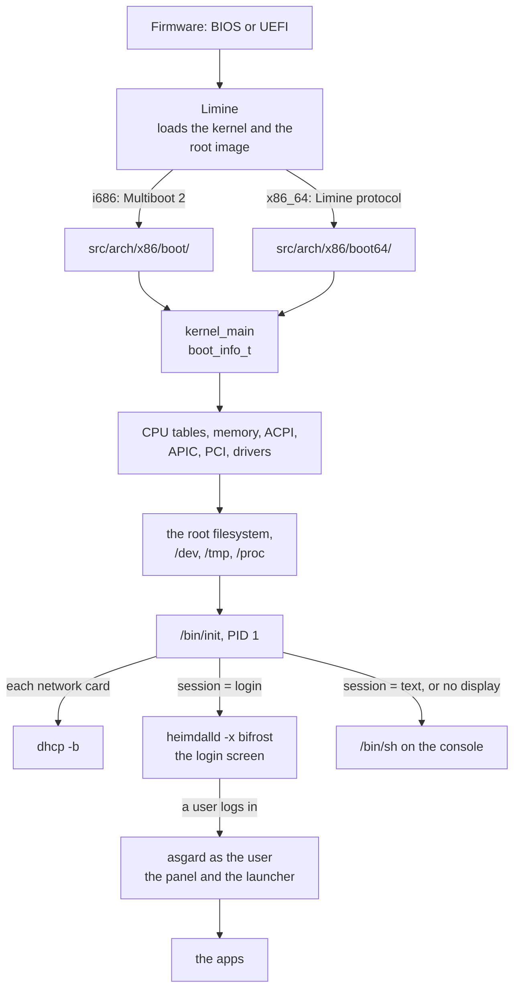
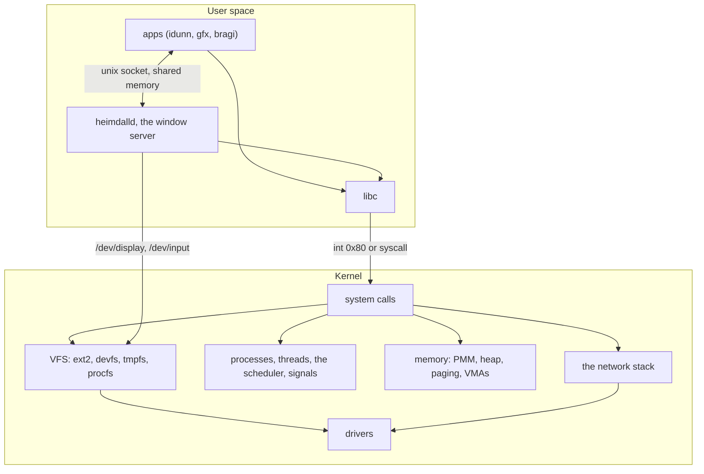

# The architecture

This page shows how ginnOS starts, from the power button to the desktop,
and how its parts work together. Each part has its code path, and later
pages in this part tell more about each one.

The code: [`src/kernel/kernel.c`](https://github.com/lassedtu/ginnOS/blob/main/src/kernel/kernel.c)
(`kernel_main`), [`src/user/init/`](https://github.com/lassedtu/ginnOS/tree/main/src/user/init)

## From the power button to the desktop

1. **The firmware** starts Limine from the disk or the USB stick. Limine
   boots with BIOS and with UEFI.
2. **Limine** loads the kernel ELF file and a copy of the root
   filesystem as a module. It sets up a framebuffer. The configuration
   is in [`tools/limine/`](https://github.com/lassedtu/ginnOS/tree/main/tools/limine).
3. **The entry code** reads what the bootloader gives (the memory map,
   the framebuffer, the ACPI tables, the command line, the module) into
   one structure, `boot_info_t`
   ([`src/common/boot/boot_info.h`](https://github.com/lassedtu/ginnOS/blob/main/src/common/boot/boot_info.h)).
   The i686 kernel uses Multiboot 2. The x86_64 kernel uses the Limine
   boot protocol.
4. **`kernel_main`** starts the parts of the kernel in this order:
   - the kernel log, the device registry, the input devices and the
     pseudo-terminals;
   - the CPU tables (GDT, IDT, TSS) and the 8259 PICs;
   - the physical memory manager, the kernel heap, the paging, the
     kernel stacks;
   - the framebuffer and the console;
   - PCI, ACPI, the APIC and its timer;
   - the drivers: the PS/2 mouse, USB (xHCI), sound (HDA, else AC'97),
     the display and virtio-gpu, the network stack and virtio-net;
   - the system calls, the processes, the scheduler, the clock and the
     random number generator.

   Then it turns on the interrupts and looks for the root filesystem on
   the disks.
5. **The root filesystem** is the first ext2 partition with the label
   `GINNOS_EXT2` on an IDE, SATA or NVMe disk. If there is none, it is
   the copy that Limine loaded into RAM. The kernel then mounts devfs at
   `/dev`, tmpfs at `/tmp` and procfs at `/proc`.
6. **`/bin/init`** starts as process 1. If it is not there, the kernel
   starts `/bin/sh`. init starts `dhcp -b` for each network card. Then it
   reads `/etc/ginnos/boot.conf` and starts the login screen or the
   shell. It starts the session again when it stops, and it collects
   every process whose parent stopped.
7. **The login screen** is Bifrost in the window server:
   `heimdalld -x bifrost`. When a user logs in, Bifrost starts asgard,
   the panel, as that user. When the user logs out, Bifrost stops all of
   the user's processes and shows the login screen again.

## The parts and how they talk

- **Programs** call the kernel through libc. On i686 the system call
  instruction is `int 0x80`. On x86_64 it is `syscall`. The numbers are
  in [`src/kernel/syscall/syscall.h`](https://github.com/lassedtu/ginnOS/blob/main/src/kernel/syscall/syscall.h).
- **The window server**, heimdalld, owns the screen, the keyboard and
  the mouse. An app connects to it on a unix socket and draws its window
  into shared memory. The protocol is in
  [`heimdall_proto.h`](https://github.com/lassedtu/ginnOS/blob/main/src/lib/heimdall/include/heimdall_proto.h).
- **Devices** are files in `/dev`. A program reads, writes, uses `ioctl`
  or maps them with `mmap`.

## Where the code is

| Part | Code |
| --- | --- |
| The boot entry, the CPU tables, paging, the context switch, the system call entry | [`src/arch/x86/`](https://github.com/lassedtu/ginnOS/tree/main/src/arch/x86) |
| Memory | [`src/kernel/memory/`](https://github.com/lassedtu/ginnOS/tree/main/src/kernel/memory) |
| Processes, threads, the scheduler | [`src/kernel/process/`](https://github.com/lassedtu/ginnOS/tree/main/src/kernel/process), [`src/kernel/scheduler/`](https://github.com/lassedtu/ginnOS/tree/main/src/kernel/scheduler) |
| Signals | [`src/kernel/signal/`](https://github.com/lassedtu/ginnOS/tree/main/src/kernel/signal) |
| The VFS and the filesystems | [`src/kernel/vfs/`](https://github.com/lassedtu/ginnOS/tree/main/src/kernel/vfs), [`src/kernel/fs/`](https://github.com/lassedtu/ginnOS/tree/main/src/kernel/fs), [`src/fs/ext2/`](https://github.com/lassedtu/ginnOS/tree/main/src/fs/ext2) |
| The system calls | [`src/kernel/syscall/`](https://github.com/lassedtu/ginnOS/tree/main/src/kernel/syscall) |
| The network stack | [`src/kernel/net/`](https://github.com/lassedtu/ginnOS/tree/main/src/kernel/net) |
| The drivers | [`src/drivers/`](https://github.com/lassedtu/ginnOS/tree/main/src/drivers) |
| The terminals and pseudo-terminals | [`src/kernel/tty/`](https://github.com/lassedtu/ginnOS/tree/main/src/kernel/tty) |
| Random numbers | [`src/kernel/random/`](https://github.com/lassedtu/ginnOS/tree/main/src/kernel/random) |
| libc | [`src/libc/`](https://github.com/lassedtu/ginnOS/tree/main/src/libc) |
| The libraries for programs | [`src/lib/`](https://github.com/lassedtu/ginnOS/tree/main/src/lib) |
| init, the window server, the desktop, the apps | [`src/user/`](https://github.com/lassedtu/ginnOS/tree/main/src/user) |
