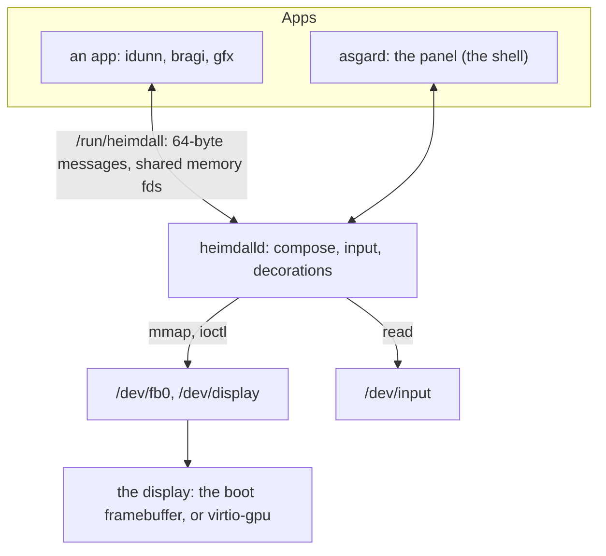
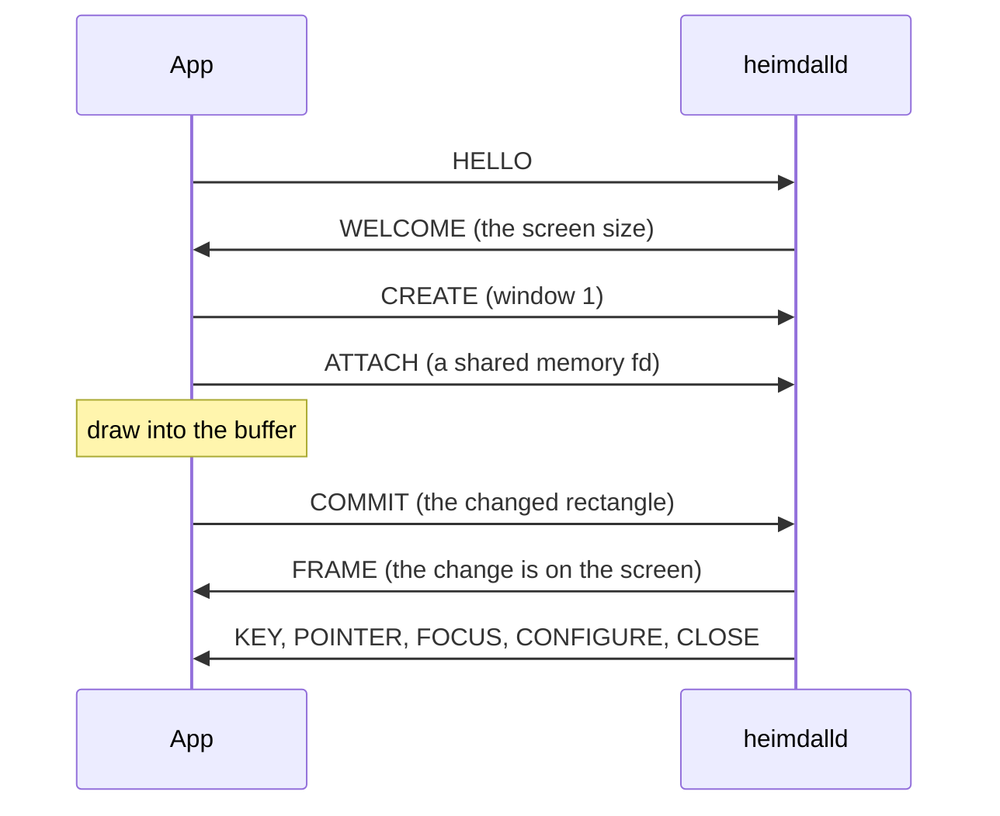

# The desktop stack

The desktop is a stack of user programs on top of the display drivers.
heimdalld is the window server. Apps draw their windows with idunn and
send them to heimdalld. asgard is the panel, and Bifrost is the login
screen. For how to use the desktop, see [The desktop](../use/desktop.md).

The code: [`src/user/heimdalld/`](https://github.com/lassedtu/ginnOS/tree/main/src/user/heimdalld),
[`src/lib/heimdall/`](https://github.com/lassedtu/ginnOS/tree/main/src/lib/heimdall),
[`src/lib/idunn/`](https://github.com/lassedtu/ginnOS/tree/main/src/lib/idunn),
[`src/user/asgard/`](https://github.com/lassedtu/ginnOS/tree/main/src/user/asgard),
[`src/user/bifrost/`](https://github.com/lassedtu/ginnOS/tree/main/src/user/bifrost),
[`src/drivers/video/`](https://github.com/lassedtu/ginnOS/tree/main/src/drivers/video)



## The display

Limine sets up a framebuffer before the kernel starts. Without a display
driver, the screen stays in that mode. The virtio-gpu driver can change
the mode at run time, and knows the size of the QEMU window. `make run`
gives QEMU a virtio-gpu card (`QEMU_VGA=virtio`).

| Device | What it gives |
| --- | --- |
| `/dev/fb0` | the framebuffer, with the Linux fbdev `ioctl`s for its size and format, and `mmap` for its pixels |
| `/dev/display` | the modes, and an event when the mode or the size that the screen wants changes |
| `/dev/input` | key and pointer events from the PS/2 keyboard and mouse and from USB devices |

## heimdalld

heimdalld owns the screen, the keyboard and the mouse.

- It keeps one picture of the screen (the composition): the wallpaper,
  then the windows from the back to the front, each with its title bar
  and shadow, then the pointer. When a window changes, it draws only the
  changed parts again, and copies them to the framebuffer.
- It reads `/dev/input`. Keys go to the window with the focus. Pointer
  events go to the window under the pointer.
- It draws the title bars and the buttons of the windows itself
  (server-side decorations). The size of a window is the size of its
  content.
- It places new windows, and does the move, the resize, maximize and
  minimize.
- It has the keys Alt+Tab, Alt+F4 and Ctrl+Alt+Backspace.

```
heimdalld [-s] [-x] [-w image] [program [arguments]]
```

| Option | Result |
| --- | --- |
| `program` | starts the program when the socket is ready |
| `-x` | stops when the program stops. `startde` runs `heimdalld -x asgard`, and init runs `heimdalld -x bifrost`. |
| `-w image` | the wallpaper. Without it, `[desktop] wallpaper` of `desktop.conf`, else `/usr/share/wallpapers/default.png`. |
| `-s` | writes statistics to the kernel log every 2 seconds: frames, pixels, and the time to compose, present and flush |

## The protocol

A client connects to the Unix socket `/run/heimdall`. Each message is
64 bytes, in both directions. A message that gives a shared memory
buffer sends its file descriptor with `SCM_RIGHTS`. The messages are in
[`heimdall_proto.h`](https://github.com/lassedtu/ginnOS/blob/main/src/lib/heimdall/include/heimdall_proto.h).



- The app draws into the shared memory, with premultiplied ARGB
  pixels. A window shows after its first `COMMIT`.
- After a `COMMIT`, heimdalld sends `FRAME` when the change is on the
  screen. An app that draws again before `FRAME` can show half a
  picture.
- `CONFIGURE` asks the app for a new size (maximize, or a resize with
  the mouse). The app attaches a buffer of that size and commits it.
- A popup (a menu, the choices of a select, a tooltip) is a window
  with a parent. `PLACE` puts it next to a rectangle in the parent. A
  press outside the open popups closes them.
- A panel is a window at the bottom of the screen, across its full
  width, above the other windows.
- The shell (the first client that sends `SHELL`, normally asgard) gets
  an event for each window that shows, changes or goes. It can
  activate, minimize and close any window, and end the session.
- `SETTINGS` tells heimdalld that a settings file changed. heimdalld
  tells all clients, and they read the file again. `conf` and Settings
  send it.
- The clipboard is text: `CLIP_SET` and `CLIP_GET`.

libheimdall
([`heimdall.h`](https://github.com/lassedtu/ginnOS/blob/main/src/lib/heimdall/include/heimdall.h))
does the protocol for a program: `heim_connect`, `heim_window_new`,
`heim_window_buffer`, `heim_window_commit`, `heim_next_event`.

## idunn

idunn is the widget toolkit. An app makes a tree of widgets, puts it in
a window, and runs the app loop. idunn lays out the widgets, draws only
what changed, in step with `FRAME`, and gives the keys and the pointer
to the widgets.

| Kind | Widgets |
| --- | --- |
| layout | row, column, card, scroll view, spacer, tabs |
| text | label, text field, text area, field (a label with an input) |
| buttons and choices | button, icon button, check box, radio group, switch, slider, select |
| lists | list view, grid view, list heads, icon view, empty state |
| other | badge, progress, separator, dialog, file dialog, menu, canvas (draw yourself) |

The look comes from the theme
([`idunn_theme.h`](https://github.com/lassedtu/ginnOS/blob/main/src/lib/idunn/include/idunn_theme.h)):
design tokens for the colours, the sizes, the text styles and the
shadows. The widgets and heimdalld use the token names, not numbers. The
theme reads `theme.conf` (see
[The settings files](../use/settings-files.md)), and changes at once when
the file changes.

Sizes are in design pixels. The scale (1 or 2) makes everything larger
on a large screen.

## asgard and Bifrost

asgard is the panel: the launcher, a button for each window, the
keyboard layout, the volume and the clock. It is the shell client of
heimdalld.

Bifrost is the login screen. init starts `heimdalld -x bifrost` as root.
When a user logs in, Bifrost checks the password in `/etc/shadow`, and
starts asgard as that user. When the user logs out, Bifrost stops the
processes of the session and shows the login screen again.
