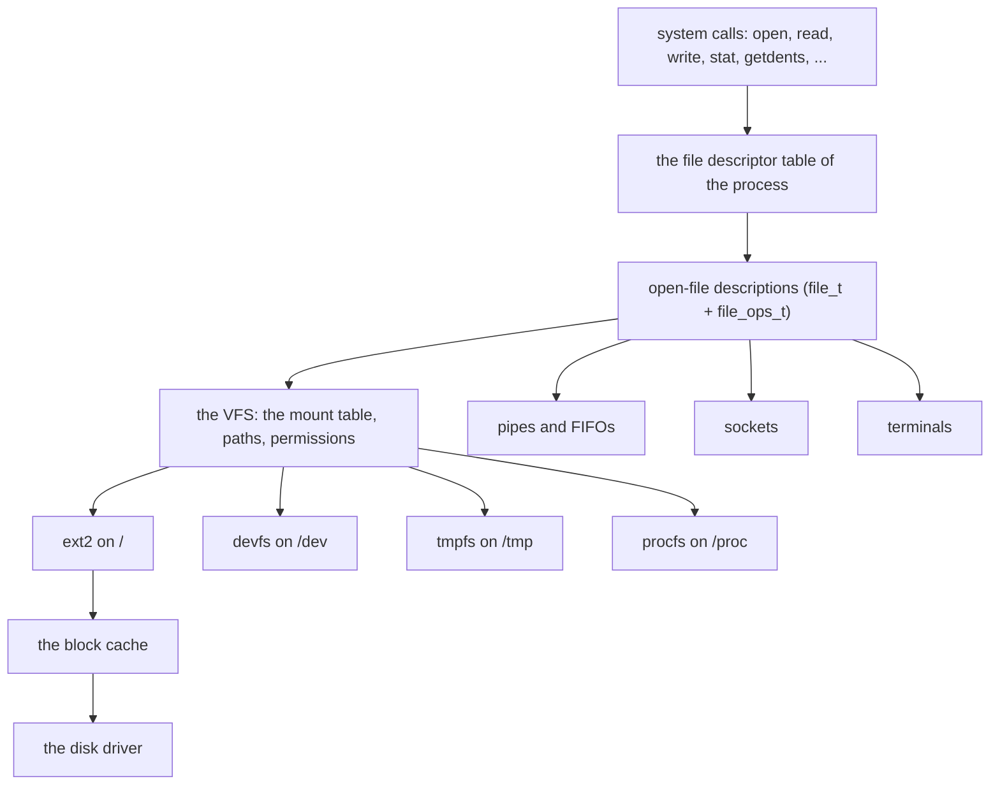

# The file systems

The virtual file system (VFS) gives all file systems one interface:
`open`, `read`, `write`, `stat`, `getdents` and the others. ginnOS has
four file systems: ext2 on the disk, and devfs, tmpfs and procfs in
memory.

The code: [`src/kernel/vfs/`](https://github.com/lassedtu/ginnOS/tree/main/src/kernel/vfs),
[`src/kernel/fs/`](https://github.com/lassedtu/ginnOS/tree/main/src/kernel/fs),
[`src/fs/ext2/`](https://github.com/lassedtu/ginnOS/tree/main/src/fs/ext2)

## The mounts

| Path | File system | What it has |
| --- | --- | --- |
| `/` | ext2 | the root file system, from the disk or from the copy in RAM |
| `/dev` | devfs | the devices |
| `/tmp` | tmpfs | files in kernel memory, 8 MiB at most. They go at reboot. |
| `/proc` | procfs | the state of the kernel, as text |

The kernel mounts these four at boot. There is no `mount` system call.
The mount table finds the mount with the longest path that matches the
start of a path.

## Open files

A file descriptor points to an open-file description (`file_t`). `dup`,
`dup2` and `fork` share the description, so they share the file
offset and the status flags. The description closes when its last
descriptor closes.

Each kind of file (a file of a file system, a pipe end, a socket, a
terminal) gives its own `file_ops_t`, so the system calls do not look
at the kind.

`poll` and `select` ask each file if it is ready. A process in `poll`
sleeps on one shared queue. A change that can make a file ready (data in
a pipe, a key press) wakes all processes in `poll`, and each checks its
files again.

## Paths and permissions

Paths are absolute in the VFS. The kernel adds the current folder of
the process to a relative path, and removes `.` and `..`. It follows up
to 40 symbolic links in one path, then returns `ELOOP`.

The permission check uses the effective user ID: the bits of the owner,
of the group, or of the others. Root can read and write all files, and
run each file that has at least one execute bit. The kernel checks the
file and its parent folder. It does not check the folders above the
parent.

`flock` gives advisory locks on whole files.

## ext2

The ext2 driver reads and writes the ext2 format: files, folders, hard
links, symbolic links (short targets in the inode), named pipes and
device nodes. A file can use direct, indirect, double indirect and
triple indirect blocks. The driver refuses a file system with an
incompatible feature other than `filetype`, so ext3 journals and ext4
extents do not work.

The root file system is the first partition with the label
`GINNOS_EXT2` on an IDE, SATA or NVMe disk. If there is none, it is the
image that Limine loaded into RAM. The build makes the image with
[`tools/ext2/make_image.py`](https://github.com/lassedtu/ginnOS/blob/main/tools/ext2/make_image.py),
and the owners and modes of its files are in
[`tools/ext2/permissions`](https://github.com/lassedtu/ginnOS/blob/main/tools/ext2/permissions).

One mutex protects the ext2 driver, so one process uses it at a time.

### The block cache

A cache of 1024 sectors (256 sets, 4 sectors each) is between ext2 and
the disk. A read uses the cache. A write goes to the disk at once and
also updates the cache (write through), so the disk always has the
data.

## devfs

devfs shows the devices that the drivers register. You cannot make or
remove files in it. Each device gives its own `read`, `write`, `ioctl`
and `mmap`. In QEMU with `make run`, `/dev` has:

| Device | What it is |
| --- | --- |
| `hda`, `hda1` | the first disk, and its partitions |
| `fb0`, `display` | the framebuffer, and the display for the window server |
| `kbd`, `input` | the keyboard, and the input events (keys and pointer) |
| `tty0` | the console |
| `ptmx`, `pts/` | the pseudo-terminals |
| `dsp` | the sound card (only with a sound card) |
| `null`, `zero`, `random`, `urandom` | the usual devices |
| `kmsg` | the kernel log |
| `pit` | the timer |

## tmpfs

tmpfs keeps each file in one buffer on the kernel heap, which grows
when you write. It has folders and symbolic links, but no hard links.
A file that is removed while it is open stays until its last close.

## procfs

| File | What it shows |
| --- | --- |
| `/proc/meminfo` | the physical memory and the kernel heap |
| `/proc/uptime` | the seconds since boot |
| `/proc/pci` | the PCI functions |
| `/proc/interrupts` | the device interrupts and their counts |
| `/proc/audio` | the sound device and its counters |
| `/proc/net` | the network interfaces and their counters |
| `/proc/<pid>/status` | the name, state, parent and resources of a process |
| `/proc/self` | the folder of the process that reads it |

procfs makes the text of a file when you open it. A program that reads
the file in parts gets one consistent copy.
