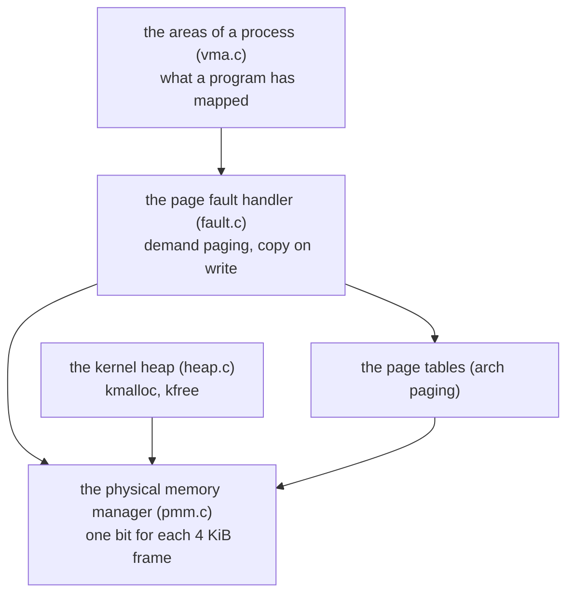

# Memory

The kernel manages memory in four layers: the physical frames, the
kernel heap, the page tables, and the areas of each process.

The code: [`src/kernel/memory/`](https://github.com/lassedtu/ginnOS/tree/main/src/kernel/memory),
[`src/arch/x86/cpu/paging.c`](https://github.com/lassedtu/ginnOS/blob/main/src/arch/x86/cpu/paging.c) (i686),
[`src/arch/x86/cpu/paging64.c`](https://github.com/lassedtu/ginnOS/blob/main/src/arch/x86/cpu/paging64.c) (x86_64)

## The address space

A page is 4 KiB on both architectures. The kernel is in the upper part
of each address space, and the same in all of them. A program is in the
lower part.

| Area | i686 | x86_64 |
| --- | --- | --- |
| never mapped (catches NULL pointers) | `0x00000000` | `0x0000000000000000` |
| the program: text, data, bss, then the heap (`sbrk`) | from `0x00400000` | from `0x0000000000400000` |
| `mmap` | `0x40000000` to `0xB0000000` | from `0x0000100000000000` |
| the stack (up to 16 MiB), and a guard page above it | below `0xBFFFF000` | below `0x00007FFFFFFFF000` |
| the direct map of RAM | from `0xC0000000` (512 MiB) | from `0xFFFF800000000000` |
| kernel stacks | from `0xE0000000` | from `0xFFFFC00000000000` |
| device memory (`ioremap`) | `0xF0000000` to `0xF4000000` | from `0xFFFFD00000000000` |
| the kernel image | in the direct map | from `0xFFFFFFFF80000000` |

The constants are in
[`memory_layout.h`](https://github.com/lassedtu/ginnOS/blob/main/src/kernel/memory/memory_layout.h).
On i686, the kernel uses only the first 512 MiB of RAM.

The kernel reaches all RAM through the **direct map**: physical address
`P` is at virtual address `P + KERNEL_VIRT_BASE`. `phys_to_virt` and
`virt_to_phys` convert between them. Device memory, for example a
framebuffer, is outside RAM. `ioremap` maps it into the device window.

## Physical frames

The physical memory manager (PMM) has one bit for each 4 KiB frame: 1
is free, 0 is used. At boot, it reads the memory map from the
bootloader and marks the kernel, the boot modules and the reserved
areas as used. A spinlock that masks interrupts protects the bitmap.

## The kernel heap

`kmalloc`, `kcalloc`, `krealloc` and `kfree` allocate kernel memory.
The heap starts with 64 KiB and grows by 64 KiB or more when it needs
memory. It grows in place when the frames after it are free. If they
are not free, it adds a new segment.

## Kernel stacks

Each process has a kernel stack of two pages in the kernel stack
region. Below each stack is a guard page that is not mapped. A kernel
stack that overflows causes a page fault, and does not change other
memory.

## The areas of a process

Each process has a table of areas: the ranges that it has mapped, with
their protection and their kind (an ELF segment, the heap, the stack,
an anonymous `mmap`, or a device `mmap`). The table is sorted and the
areas do not overlap. The threads of a process share one table.

`mmap`, `munmap`, `mprotect` and `brk` change the table and the page
tables together
([`mm.c`](https://github.com/lassedtu/ginnOS/blob/main/src/kernel/memory/mm.c)).

## Page faults

The kernel does not give a frame to all memory of a process at once.
The heap, an anonymous `mmap` and most of the stack get a frame the
first time that the process touches them (demand paging).

When a process touches a page:

- If the page is in an area that allows the access, and has no frame,
  the kernel gives it a zeroed frame.
- If the page is shared after `fork` and the process writes to it, the
  kernel gives the process its own copy (copy on write).
- If no area allows the access, the kernel stops the process with
  `SIGSEGV`.

Before the kernel copies data to or from a user pointer in a system
call, it does the same steps for each page. A bad pointer from a
program then gives `EFAULT`, and does not crash the kernel.

## fork and copy on write

`fork` does not copy the memory of the process. The parent and the
child share each frame read-only. The first write to a page in a
writable area makes a copy for the process that writes. Shared memory
(`MAP_SHARED`) stays shared and writable after `fork`.

## Shared memory

`shm_create(size, flags)` makes a shared memory object of zeroed pages
and returns a file descriptor. Each `mmap` of that descriptor, in any
process, maps the same frames. A process gets the descriptor through
`fork` or over a Unix socket. The window server and the apps use this
for the pixels of each window.

The object stays while its file is open or while a mapping of it
exists.
