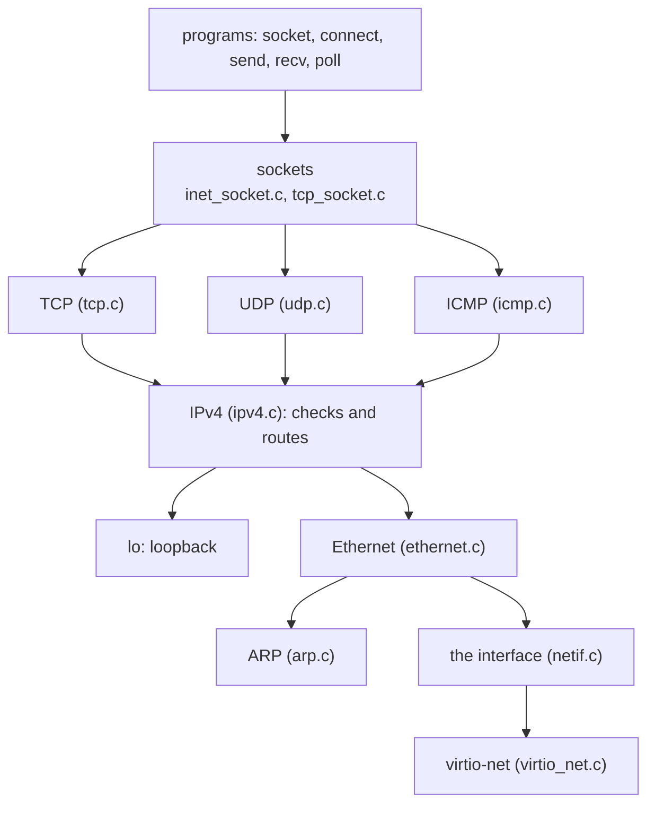

# The network stack

The kernel has its own IPv4 stack: Ethernet, ARP, IPv4, ICMP, UDP and
TCP, with BSD sockets for programs. For how to use the network, see
[The network](../use/networking.md).

The code: [`src/kernel/net/`](https://github.com/lassedtu/ginnOS/tree/main/src/kernel/net),
[`src/drivers/net/virtio_net.c`](https://github.com/lassedtu/ginnOS/blob/main/src/drivers/net/virtio_net.c),
[`src/kernel/ipc/unix_socket.c`](https://github.com/lassedtu/ginnOS/blob/main/src/kernel/ipc/unix_socket.c)

## The way of a packet

A received frame goes up:

1. The virtio-net interrupt handler gives the frame to
   `netif_receive`.
2. Ethernet looks at the type: ARP or IPv4.
3. IPv4 checks the header and the checksum, and gives the packet to
   ICMP, UDP or TCP.
4. UDP and ICMP put the datagram in the queue of the socket. TCP puts
   the bytes in the receive buffer of the connection.
5. The stack wakes the processes that wait on the socket.

The stack does all this in the interrupt handler. One spinlock,
`net_lock`, protects all network state. On one CPU, a system call that
sends holds the lock with interrupts off, so the receive path cannot
run at the same time.

## The layers

| Layer | What it does | What it does not do |
| --- | --- | --- |
| virtio-net | queue 0 receives, queue 1 sends. 2 KiB buffers. | offloads (checksums, segmentation) |
| Ethernet | Ethernet II frames | VLANs |
| ARP | a cache of 16 addresses for 300 seconds. A packet waits while the request goes out. | |
| IPv4 | the header checks and the routes (see below). Each packet has "don't fragment". | joining fragments: the stack drops them |
| ICMP | echo replies, "unreachable", and ping sockets | |
| UDP | datagrams. A socket queues up to 64 KiB. | |
| TCP | the handshake, a listen queue, retransmission with a timeout from the round-trip time, fast retransmit, slow start and congestion avoidance, the MSS option, zero window probes, FIN and RST | segments out of order (the stack drops them, and the sender sends them again), selective acks, timestamps, window scaling (so 64 KiB at most), keepalive, delayed acks, Nagle |

### Routes

- `127.0.0.0/8` goes to `lo`.
- An address on the local network of an interface goes to that
  interface.
- All other addresses go to the gateway of the first interface that has
  one.
- `255.255.255.255` goes to all hosts on the first Ethernet interface,
  also before it has an address. DHCP needs this.

There is no routing table. `ip route set default` sets the gateway of an
interface.

## Sockets

| Socket | What it is |
| --- | --- |
| `AF_INET`, `SOCK_STREAM` | TCP |
| `AF_INET`, `SOCK_DGRAM` | UDP |
| `AF_INET`, `SOCK_DGRAM`, `IPPROTO_ICMP` | ICMP echo, as the ping sockets of Linux. The kernel sets the identifier and the checksum, so a program does not need root. |
| `AF_UNIX`, `SOCK_STREAM` | local streams, which can pass open files (`SCM_RIGHTS`) |

The structures and the constants are the same as on Linux. A socket
works with `read`, `write`, `poll`, `select`, `send`, `recv`,
`sendmsg` and `recvmsg`.

`setsockopt` accepts `SO_REUSEADDR`, `SO_BROADCAST`, `SO_SNDBUF`,
`SO_RCVBUF`, `SO_KEEPALIVE` and the `TCP_*` options, so ported programs
work. Small writes always go at once, as with `TCP_NODELAY`.

### Unix sockets

A server binds a Unix socket to a name and listens. A client connects
to the name. The names are in a table in the kernel, not in the file
system: any path is a name, and no file shows in the folder.

`sendmsg` with `SCM_RIGHTS` passes open files to the other process. The
window server and the apps use this to share the shared memory of each
window.

## Names

The kernel does not look up names. libc reads `/etc/hosts`, then asks
the name servers in `/etc/resolv.conf` over UDP
([`src/libc/src/dns.c`](https://github.com/lassedtu/ginnOS/blob/main/src/libc/src/dns.c)).
`dhcp` in user space gets the address and writes `resolv.conf`.

## See the counters

`/proc/net` has one line for each interface: the name, the MAC
address, the MTU, then the packets, the bytes and the drops that it
received, and the same that it sent.
