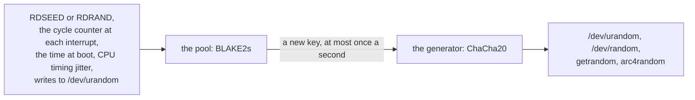

# Random numbers

The kernel makes random numbers for itself and for programs: TCP
sequence numbers, DNS query IDs, TLS keys, and password salts.

The code: [`src/kernel/random/`](https://github.com/lassedtu/ginnOS/tree/main/src/kernel/random)



## The pool

All input goes into a BLAKE2s hash, the pool:

- the hardware generator of the CPU (`RDSEED`, else `RDRAND`), if the
  CPU has one;
- the cycle counter at each interrupt;
- the time at boot;
- jitter in CPU timing, measured at boot;
- data that a program writes to `/dev/urandom`.

The kernel estimates how many bits of entropy the pool has. When it has
enough, the generator is "seeded". With `RDSEED` or `RDRAND` this
happens at once. Without them, the jitter at boot and the interrupts
seed it. The kernel log shows it:

```
random: seeded, 16 words from the CPU
```

## The generator

The generator is ChaCha20 with a 256-bit key. When the pool has new
input, the generator takes a new key from the pool, at most once a
second. After each request, the generator also makes a new key from its
own output (fast key erasure). A person who reads the state later
cannot find the numbers that it made before.

## For programs

| Interface | When it waits |
| --- | --- |
| `/dev/urandom` | never |
| `/dev/random` | never (it is the same as `/dev/urandom`) |
| `getrandom(buf, len, 0)` | until the generator is seeded |
| `getrandom(buf, len, GRND_NONBLOCK)` | never: `EAGAIN` if it is not seeded |
| `getentropy`, `arc4random`, `arc4random_buf`, `arc4random_uniform` | like `getrandom` (libc) |
