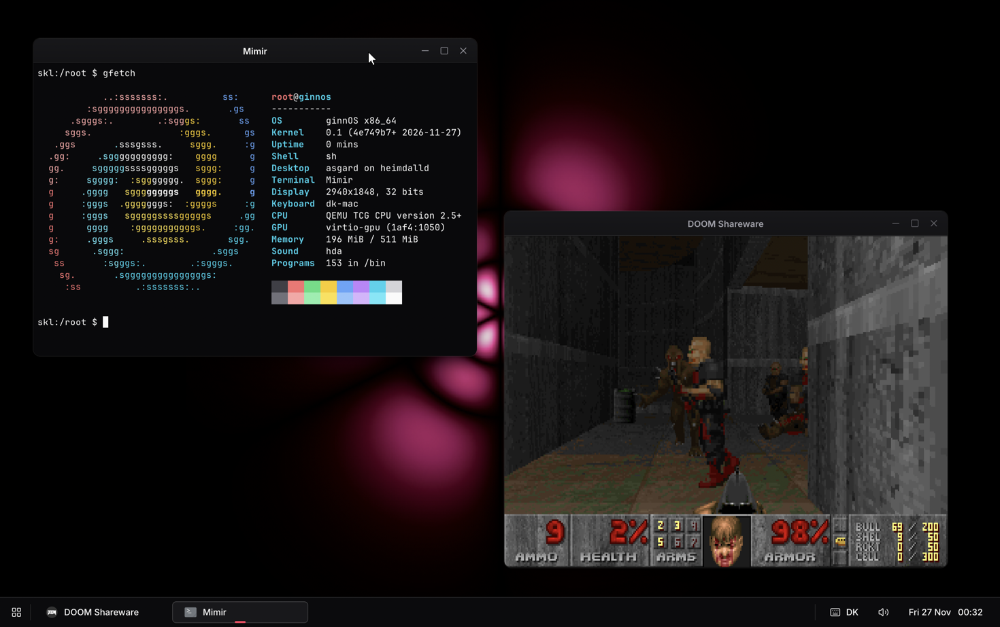

# The desktop

The ginnOS desktop has a panel at the bottom of the screen and windows
above it. You open apps from the launcher in the panel.



The code: [`src/user/heimdalld/`](https://github.com/lassedtu/ginnOS/tree/main/src/user/heimdalld)
(the window server), [`src/user/asgard/`](https://github.com/lassedtu/ginnOS/tree/main/src/user/asgard)
(the panel and the launcher), [`src/user/bifrost/`](https://github.com/lassedtu/ginnOS/tree/main/src/user/bifrost)
(the login screen)

## Log in and log out

ginnOS starts with the login screen. To log in, see
[Get started](getting-started.md#log-in).

To log out, open the launcher and click the Log out button at the
bottom right. All the windows of your session close, and the login
screen comes back.

## The panel

The panel has three parts:

| Part | What it does |
| --- | --- |
| Apps (left) | opens the launcher |
| the window buttons (middle) | one button for each open window |
| the right side | the keyboard layout, the volume and the clock |

### The launcher

Click Apps to open the launcher. The Search apps field has the keyboard
when the launcher opens.

- Type to find an app by its name, its description or its command. The
  search looks in all categories.
- Press Enter to start the first app that the launcher shows.
- Press Down to go into the grid of apps, and Up from its top row to go
  back to the search field.
- Press Escape to close the launcher.
- Click a category (All, Accessories, Development, Games, Graphics,
  Sound, System, Other) to show only its apps.

The apps that you used last are first in the grid.

The bottom row of the launcher shows your user name, and the Log out
button. For `root`, it also shows the Restart and Power off buttons.

### The window buttons

Each open window has a button in the panel. A minimized window has a
dimmer button.

| Action | Result |
| --- | --- |
| Click | The window comes to the front. If it is already at the front, it minimizes. |
| Middle-click | The window closes. |
| Right-click | A menu with Minimize, Restore or Bring to front, and Close. |

### The right side of the panel

- **The keyboard layout** shows the short name of the layout, for example
  DK. Click it to select a different layout.
- **The volume** opens a slider. The slider sets the volume of the sound
  card.
- **The clock** opens a calendar of the month.

## Windows

Each window has a title bar with three buttons at the right: minimize,
maximize (or restore) and close. A window that cannot change its size
has no maximize button.

| Action | Result |
| --- | --- |
| Drag the title bar | The window moves. |
| Double-click the title bar | The window maximizes, or goes back to its size. |
| Drag an edge or a corner | The window changes its size. |

The window server has these keys:

| Key | Result |
| --- | --- |
| Alt+Tab | The next window comes to the front. |
| Alt+F4 | The window at the front closes. |
| Ctrl+Alt+Backspace | The window server stops, and the console comes back. |

## Light and dark mode

ginnOS has a light and a dark theme. Select the theme in
[Settings](apps.md#settings), on the Appearance page. All open windows
and their title bars change at the same time.

The defaults for all users are in `/etc/ginnos/theme.conf`. The values
of one user are in `~/.config/ginnos/theme.conf`. You can also set a
value from the shell:

```sh
$ conf theme theme.mode light
```

## Start the desktop from the console

If ginnOS starts the shell on the console, start the desktop with:

```sh
$ startde
```

The desktop runs as the user of the shell. When you log out, the shell
on the console comes back.

To make ginnOS start the shell on the console in place of the login
screen, set `session = text` in `/etc/ginnos/boot.conf`:

```ini
[boot]
session = text
```
